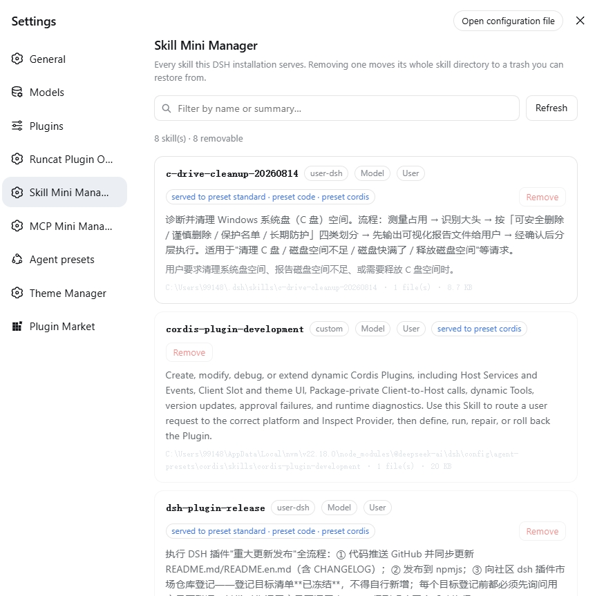

# dsh-skill-mini-manager · Skill Mini Manager

English | [中文](README.md)

One **skill manager** page inside DSH Web Settings: it lists every skill the
installation currently serves, shows each skill's own summary, and removes any
of them.

- **Plugin id**: `dsh-skill-mini-manager`
- **English name**: Skill Mini Manager
- **Chinese name**: skill 极简管理

It sits at the **same level as the built-in 插件 (Plugins) section** — its own
entry in the same tier of the Settings sidebar, not a tab inside Plugins.

## Preview



## What it shows

One row per skill:

| Field | Source |
|---|---|
| **Name** | the skill frontmatter's `name` |
| **Summary** | the skill frontmatter's `description` — the routing text the skill itself wrote, shown verbatim |
| **When to use** | the optional `whenToUse` |
| **Source** | `user-dsh` / `user-agents` / `project-dsh` / `project-agents` / `custom` / `bundled` |
| **Invocable on** | model / user (`disable-model-invocation`, `user-invocable`) |
| **Footprint** | the skill directory's absolute path, file count and byte total |
| **Served to** | which presets (or the global layer) hand this skill to an agent |

The top of the page carries a filter (name, summary or when-to-use), a refresh
action and a count; the trash sits at the bottom.

### Which layer a skill lives in (important)

The DSH skill registry is **host + per-scope layered**: deployment-level
providers register into the **global layer**, while each agent preset's own
`skill-filesystem` row registers into **that preset's layer**. The catch is that
`dsh-web-app`'s patch **disables the host `skill-filesystem` row** ("presets own
local discovery"), so on a stock web profile **the global layer is empty** and
every user skill lives in a preset layer — reading the global layer alone yields
an empty catalog.

So this plugin reads **every view**: the global layer plus each preset in the
roster, merged by name. A preset is read through the standing scope key from
`AgentPresets.standingKeyFor(id)` — the scope DSH documents for a host reader
with no agent. A preset that cannot be read is **reported on the page** rather
than silently costing you rows.

Each skill therefore names the presets that **serve it** (e.g.
`served to preset standard · preset code`), and a skill from a preset-private
`skills/` directory (such as the two the shipped `cordis` preset carries) names
only that preset. A name that resolves to **different files** in different
presets is listed but never offered for removal (`ambiguous`).

Everything comes from the host's live `ctx.skills` registry: every open or
refresh re-reads it with no caching, so the page shows what the model can load
right now.

## How removal works

**Remove** opens a two-step confirm that names the exact path that will move.
On confirmation the host:

1. **Moves** the whole skill directory (or the single `.md` file of a flat skill)
   to `<DSH_HOME>/.skill-mini-manager/trash/<stamp>-<name>-<nonce>/payload`,
   writing a `meta.json` beside it that records the original path.
2. That location is outside every scanned skill root, so the filesystem
   provider's one-level discovery can never see it again — the skill leaves the
   model catalog immediately (the provider's own watcher invalidates).
3. The **trash** at the bottom of the page lists removed skills, each with a
   **Restore** action that moves it back to its original path. **Empty trash**
   is the only irreversible verb in the plugin, and it confirms first too.

## What cannot be removed

Refusals are enforced on the host; the page shows the reason instead of a button.

| Reason | Meaning |
|---|---|
| `bundled-source` | a DSH-bundled skill (`DSH_BUNDLED_SKILL_DIR`) — a distribution artifact, not user content |
| `runtime-provider` | registered by a plugin at runtime; it has no files |
| `system-owned` | inside the system-owned `.system` directory |
| `not-on-disk` | the definition carries no file path |
| `outside-skill-roots` | outside every known skill root |
| `unsupported-layout` | neither `<name>/SKILL.md` nor `<name>.md` |
| `missing` | the directory is there but `SKILL.md` is gone |
| `ambiguous` | the name resolves to different files in different preset layers; the page sends only a name, so there is no single target and it refuses to guess |

Plus two structural guarantees:

- **The browser never sends a path.** The page sends a skill name (`remove`) or
  a trash entry id (`restore`/`purge`); the host re-derives the target from its
  own rules every time. A compromised page cannot make this plugin delete an
  arbitrary file.
- **The removal target is never a skill root itself.** A bare `SKILL.md` sitting
  directly in a root is refused rather than taking the whole `skills/` directory
  with it.

## Host interface

The host half mounts four exact routes on `webServer`. All of them accept
same-origin requests only (an `Origin` that disagrees with `Host` is a 403):

| Method | Path | Effect |
|---|---|---|
| `GET` | `/dsh-skill-mini-manager/api/catalog` | skills + trash + root status |
| `POST` | `/dsh-skill-mini-manager/api/remove` | `{"name":"<skill>"}` |
| `POST` | `/dsh-skill-mini-manager/api/restore` | `{"id":"<trash entry>"}` |
| `POST` | `/dsh-skill-mini-manager/api/purge` | empty the trash |

## Installing

This is a standard DSH bundle (it declares `dsh.bundle.patch` and `dsh.client`):
add it to a profile and **restart**.

### Straight from GitHub

```bash
dsh plugin --profile web add github:runcat-tommy/dsh-skill-mini-manager
```

This needs `git` on the machine. The repository ships **no build artifacts and no
`prepare` script**, so a build approval is not normally triggered; approve it if
DSH asks. Updating means re-running the same command.

### From a local checkout

```bash
git clone https://github.com/runcat-tommy/dsh-skill-mini-manager.git
dsh plugin --profile web add D:\path\to\dsh-skill-mini-manager
```

`dsh plugin` is a forwarding shell around `pnpm`: it runs `pnpm add` inside the
profile directory, then realigns `dsh.profile.bundles` with what actually got
loaded. So you may also mount it by hand with `pnpm add link:<path>` — in that
case add the package name to `dsh.profile.bundles` yourself, because `pnpm add`
will not:

```json
{
  "dsh": {
    "profile": {
      "bundles": ["@deepseek-ai/dsh-base", "@deepseek-ai/dsh-web-app", "dsh-skill-mini-manager"]
    }
  }
}
```

Update with `git pull` and a re-run of `add`.

**Either route needs one `dsh web` restart**: the host half mounts its routes at
startup. A mere page refresh makes the page say so explicitly ("the plugin's host
half did not answer").

Uninstall with `dsh plugin --profile web remove dsh-skill-mini-manager`. (Removing
a *skill* is a different thing; this plugin never touches package dependencies.)

## What ships

| File | Role |
|---|---|
| `lib/index.js` | host half: the four routes, the trash, every refusal rule |
| `lib/catalog.js` | the pure core: home/root resolution, `planRemoval`, trash-name validation |
| `lib/client.js` | browser half: a hand-written `__ModuleLoader__` bundle registering the `settings.section` |
| `test/` | 61 tests: pure rules, host half over real temp directories (including the layered read), browser-half structure, release-artifact gates |
| `scripts/inspect-live-catalog.mjs` | read-only probe: run the catalog and removal planning over the skills actually installed here |

The browser half needs no build step: it requires only the `react` platform seed
and talks to its host half over same-origin `fetch`. All copy is registered
bilingually through the `locale` service and follows the DSH UI language.

## Developing

```bash
node --test "test/*.test.mjs"          # all 61 tests
node scripts/inspect-live-catalog.mjs  # read-only check against the real installed skills
```

## Model experience

**None.** This plugin registers no prompt, tool, message or provider request.
Its only model-visible effect is indirect: removing a skill makes the filesystem
provider drop it from the model catalog — which is exactly what removal means,
and the catalog itself is rendered by `@deepseek-ai/dsh-tool-skill`.

#### KV cache impact

A removal trips provider invalidation, so a catalog consumer appends a
replacement catalog after the existing request history. Browsing this page adds
no model tokens.

## Known limitations and deferrals

- **User-level skills only.** The Settings panel has no workspace, so discovery
  runs without a `cwd`: project-level `.dsh/skills` and `.agents/skills` do not
  appear. Managing project skills needs an entry point that carries a workspace.
- **The verdict is path shape, not the provider's own account.** A custom root
  whose directory is not literally named `skills` is refused as
  `outside-skill-roots` — deliberately conservative, at the cost of such a
  deployment having to declare its roots.
- **Removal means "move away", not "uninstall".** The plugin never touches
  `package.json`, a registry, or plugin composition; it only moves a skill's own
  directory.
- **The trash is never cleaned up automatically.** Emptying it is a user action.
- **Every route recomputes the catalog.** With very many skills each refresh
  re-reads every definition; "minimal" here means no cache, not skipping the
  read.
