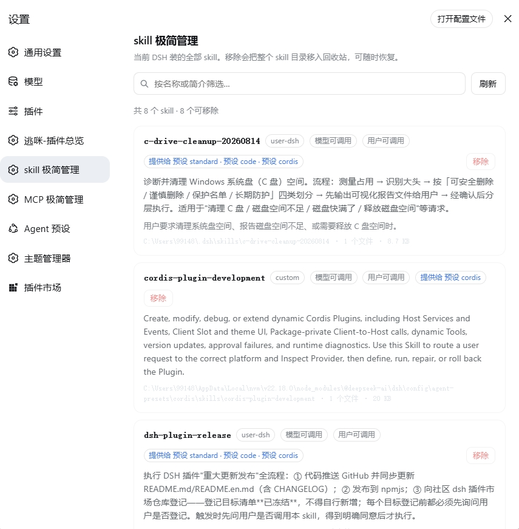

# dsh-skill-mini-manager · skill 极简管理

[English](README.en.md) | 中文

DSH Web 设置里的一页 **skill 管理器**：把当前 DSH 装的全部 skill 列出来，展示每个
skill 自己的简介，并且可以逐个移除。

- **插件 id**：`dsh-skill-mini-manager`
- **中文名**：skill 极简管理
- **英文名**：Skill Mini Manager

它的位置与内置的「**插件**」分区**同级**——设置面板左侧同一层导航里的独立一页，
不是「插件」里的一个标签页。

## 效果预览 Preview



## 它显示什么

每一行是一个 skill，显示：

| 字段 | 来源 |
|---|---|
| **名称** | skill frontmatter 的 `name` |
| **简介** | skill frontmatter 的 `description`（skill 自己写的那段路由说明，原样展示） |
| **使用时机** | 可选的 `whenToUse` |
| **来源** | `user-dsh` / `user-agents` / `project-dsh` / `project-agents` / `custom` / `bundled` |
| **可调用面** | 模型可调用 / 用户可调用（对应 `disable-model-invocation`、`user-invocable`） |
| **占用** | skill 目录的绝对路径、文件数、总字节数 |
| **提供给** | 哪些预设（或全局层）会把这个 skill 交给 agent |

页面顶部有搜索框（按名称 / 简介 / 使用时机过滤）、刷新按钮和计数，底部是回收站。

### skill 存在哪一层（重要）

DSH 的 skill 注册表是 **host + 按 scope 分层**的：部署级 provider 注册进**全局层**，
而每个 agent 预设自己的 `skill-filesystem` 行注册进**那个预设的层**。关键在于
`dsh-web-app` 的补丁**显式禁用了宿主机上的 `skill-filesystem` 行**（原注释写明
「presets own local discovery」），所以**全局层在标准 web profile 上是空的**，
所有用户 skill 都活在预设层里——只读全局层会得到一份空目录。

因此本插件**逐个读取**：全局层 + roster 里每个预设的层，然后按名称合并。预设的读取走 DSH
为「没有 agent 的宿主读取者」提供的读取 scope，**两代 API 都兼容**：

- **DSH 0.2 起**：`acquireScope(id)`，返回一个**租约**（`{ key } & AsyncDisposable`），
  读完该 scope 后必须 `dispose`，否则那份预设修订会被一直留在内存里。本插件在
  `finally` 里释放，读取抛错也照样释放。
- **DSH 0.1.x**：`standingKeyFor(id)`，直接返回 key，没有东西需要释放。

读不通的预设会**明确报在页面上**，而不是静默少列几个 skill。

于是每个 skill 会标出它被**哪些预设提供**（例如 `提供给 预设 standard · 预设 code`）；
预设自带 `skills/` 目录里的私有 skill（例如内置 `cordis` 预设的两个）只标它自己。
同名 skill 在不同预设里指向**不同文件**时，页面会列出它但标为不可移除（`ambiguous`）。

内容完全来自宿主真实运行的 `ctx.skills` 注册表：每次打开或刷新都现场读取，没有缓存，
所以页面上看到的就是模型此刻能加载的东西。

## 移除是怎么做的

点「移除」会进入二次确认，确认框里会显示**将要移动的确切路径**。确认后：

1. 宿主机把整个 skill 目录（或扁平 skill 的那一个 `.md` 文件）**移动**到
   `<DSH_HOME>/.skill-mini-manager/trash/<时间戳>-<名称>-<随机串>/payload`，并在同目录写入
   `meta.json` 记录原始路径。
2. 该位置在所有 skill 根目录之外，所以文件系统 provider 的一层发现再也看不到它——
   skill 立刻从模型目录里消失（provider 自带的 watcher 会触发失效）。
3. 页面底部的**回收站**列出已移除的 skill，每项都有**恢复**按钮，会把它移回原路径。
   **清空回收站**是插件里唯一不可逆的操作，同样需要二次确认。

## 什么不能被移除

移除在宿主侧做了一组硬性拒绝，页面会显示拒绝原因而不是给出按钮：

| 原因 | 含义 |
|---|---|
| `bundled-source` | DSH 内置打包的 skill（`DSH_BUNDLED_SKILL_DIR`），属于发行物而不是用户资产 |
| `runtime-provider` | 由插件在运行时注册的 skill，根本没有文件 |
| `system-owned` | 位于系统保留的 `.system` 目录内 |
| `not-on-disk` | 定义里没有文件路径 |
| `outside-skill-roots` | 不在任何已知 skill 根目录内 |
| `unsupported-layout` | 既不是 `<name>/SKILL.md`，也不是 `<name>.md` |
| `missing` | 目录还在但 `SKILL.md` 已经不见了 |
| `ambiguous` | 同名 skill 在不同预设层里指向不同文件；页面只发名称，没有唯一目标就不猜 |

再加两条结构性保证：

- **浏览器永远不传路径。** 页面只发 skill 名称（`remove`）或回收站条目 id（`restore`/`purge`），
  宿主每次都用自己的规则重新解析目标路径。被篡改的页面无法让这个插件去删任意文件。
- **删除目标永远不会是 skill 根目录本身。** 一个直接躺在根目录里的 `SKILL.md` 会被拒绝，
  而不是把整个 `skills/` 目录移走。

## 宿主接口

宿主半侧在 `webServer` 上挂四条 exact 路由，全部只接受同源请求（`Origin` 与 `Host`
不一致即 403）：

| 方法 | 路径 | 作用 |
|---|---|---|
| `GET` | `/dsh-skill-mini-manager/api/catalog` | skill 列表 + 回收站 + 根目录状态 |
| `POST` | `/dsh-skill-mini-manager/api/remove` | `{"name":"<skill>"}` |
| `POST` | `/dsh-skill-mini-manager/api/restore` | `{"id":"<回收站条目>"}` |
| `POST` | `/dsh-skill-mini-manager/api/purge` | 清空回收站 |

## 安装

本插件是一个标准的 DSH bundle（声明了 `dsh.bundle.patch` 与 `dsh.client`）。
三条路任选一条，装完都要**重启一次** `dsh web`。

**先说清楚一件事**：本插件**没有构建步骤**——浏览器半侧 `lib/client.js` 是手写的
`__ModuleLoader__` bundle，而且**已经提交进仓库**，`package.json` 里也没有 `prepare` 脚本。
所以三条路都不需要「先构建」，GitHub 直装通常也不会触发构建审批。

| 路 | 命令 | 适合谁 | 需要什么 | 更新方式 |
|---|---|---|---|---|
| ① npm | `dsh plugin --profile web add dsh-skill-mini-manager` | 绝大多数人：只是想用它 | 无（包内已带全部产物） | `dsh plugin --profile web up dsh-skill-mini-manager` |
| ② GitHub 直装 | `dsh plugin --profile web add github:runcat-tommy/dsh-skill-mini-manager` | 想跟仓库最新提交，而不是发布版 | 本机有 `git`；若 DSH 要求构建审批就同意 | 重跑同一条命令 |
| ③ 下载到本地 | `dsh plugin --profile web add <本地目录>` | 要读/改代码、要离线、或本机**没有 git** | 无（`git clone` 或 **Download ZIP** 都行） | 重新 `git pull` / 重新下载 |

一句话：**能装 npm 就装 npm**（一条命令、不依赖 `git`）；要跟最新提交走 ②；要动代码或没有 `git` 走 ③。

### ① 从 npm 装（推荐）

```bash
dsh plugin --profile web add dsh-skill-mini-manager
```

包内已带全部产物，不执行任何安装脚本，也不需要 `git`——前置条件最少的一条路。
发布历史见 <https://www.npmjs.com/package/dsh-skill-mini-manager>。

### ② 从 GitHub 直接装

```bash
dsh plugin --profile web add github:runcat-tommy/dsh-skill-mini-manager
```

适合想直接跟 `main` 分支最新提交的情况（npm 上是发布版，两者之间可能有时间差）。
需要本机有 `git`。仓库没有需要现场生成的构建产物、也没有 `prepare` 脚本，所以通常不会触发
构建审批；若 DSH 要求批准，按提示同意即可。更新就是重跑同一条命令。

### ③ 下载到本地再装

适合要读代码、改代码、离线使用，或者**本机根本没有 `git`** 的情况。两种下载方式都行：

```bash
# 方式 A：git clone（需要 git）
git clone https://github.com/runcat-tommy/dsh-skill-mini-manager.git
dsh plugin --profile web add D:\path\to\dsh-skill-mini-manager
```

```text
# 方式 B：不用 git（Download ZIP）
1. 打开 https://github.com/runcat-tommy/dsh-skill-mini-manager
2. Code → Download ZIP
3. 解压，然后：
   dsh plugin --profile web add D:\path\to\dsh-skill-mini-manager-main
```

⚠️ Download ZIP 解压出来的目录带 `-main` 后缀，`add` 要指向**解压后的那个目录**，
不要指向 `.zip` 文件本身。

更新走 `git pull`（或重新下载）然后重启——本插件没有构建步骤，**不需要**跑 `npm run build`。

`dsh plugin` 是 `pnpm` 的转发壳：它会在 profile 目录里跑 `pnpm add`，然后按装载后的真实状态
对齐 `dsh.profile.bundles`。所以也可以用 `pnpm add link:<路径>` 手工挂载，此时需要自己把包名
加进 `dsh.profile.bundles`（`pnpm add` 不会自动加）：

```json
{
  "dsh": {
    "profile": {
      "bundles": ["@deepseek-ai/dsh-base", "@deepseek-ai/dsh-web-app", "dsh-skill-mini-manager"]
    }
  }
}
```

### 装完必须重启

宿主半侧在启动时挂载路由。只刷新页面的话，页面会明确提示「插件的主机半侧没有响应」，
而不是静默空白。

查看与卸载：

```bash
dsh plugin --profile web list
dsh plugin --profile web remove dsh-skill-mini-manager
```

（移除 skill 是另一回事——本插件不会碰包依赖。）

## 装箱内容

| 文件 | 作用 |
|---|---|
| `lib/index.js` | 宿主半侧：四条 HTTP 路由、回收站、全部拒绝规则 |
| `lib/catalog.js` | 纯函数核心：根目录解析、`planRemoval`、回收站命名校验 |
| `lib/client.js` | 浏览器半侧：手写的 `__ModuleLoader__` bundle，注册 `settings.section` |
| `test/` | 70 个测试：纯规则、宿主半侧（真实临时目录 + 分层读取）、浏览器半侧结构、发布产物门槛 |
| `scripts/inspect-live-catalog.mjs` | 只读探针：用本机已装的 skill 跑一遍目录读取与移除规划 |

浏览器半侧不需要构建步骤：它只 `require("react")` 这一颗平台种子，其余全部用
同源 `fetch` 与宿主半侧对话。文案通过 `locale` 服务注册中英双语，跟随 DSH 界面语言。

## 开发

```bash
node --test "test/*.test.mjs"          # 全部 70 个测试
node scripts/inspect-live-catalog.mjs  # 用本机真实 skill 做只读验证
```

## 模型体验

**无。** 本插件不注册提示词、工具、消息或提供方请求。它唯一对模型的可见影响是间接的：
移除一个 skill 之后，文件系统 provider 会让该 skill 从模型目录中消失——这正是「移除」
的本意，而目录本身由 `@deepseek-ai/dsh-tool-skill` 渲染。

#### KV Cache 影响

移除会触发 provider 失效，从而使目录消费方在既有请求历史后追加一份替换目录。
浏览这一页不会增加任何模型 token。

## 已知限制与暂缓事项

- **只列用户级 skill。** 设置面板没有工作区，所以目录读取不带 `cwd`：项目根下的
  `.dsh/skills` 与 `.agents/skills` 不会出现。要管理项目 skill，需要一个带工作区上下文的入口。
- **判据是路径形状，而不是 provider 自述。** 自定义根目录只要目录名不是 `skills`，
  就会被 `outside-skill-roots` 拒绝——这是有意的保守选择，代价是这类部署需要显式声明根目录。
- **移除是「移走」而不是「卸载」。** 插件不碰 `package.json`、registry 或插件装配；
  它只搬动 skill 自己的目录。
- **回收站不会被自动清理。** 需要用户显式清空。
- **每条路由都现场重算目录。** skill 数量很大时每次刷新都会重读一遍全部定义；
  「极简」在这里意味着不做缓存，而不是省这一次读取。
